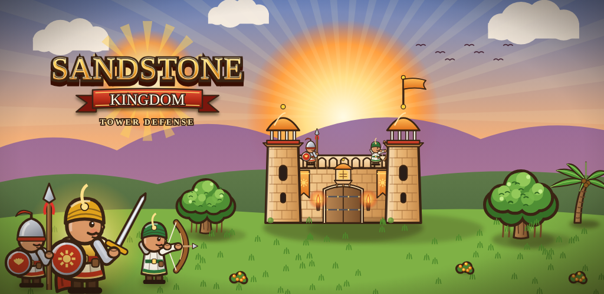
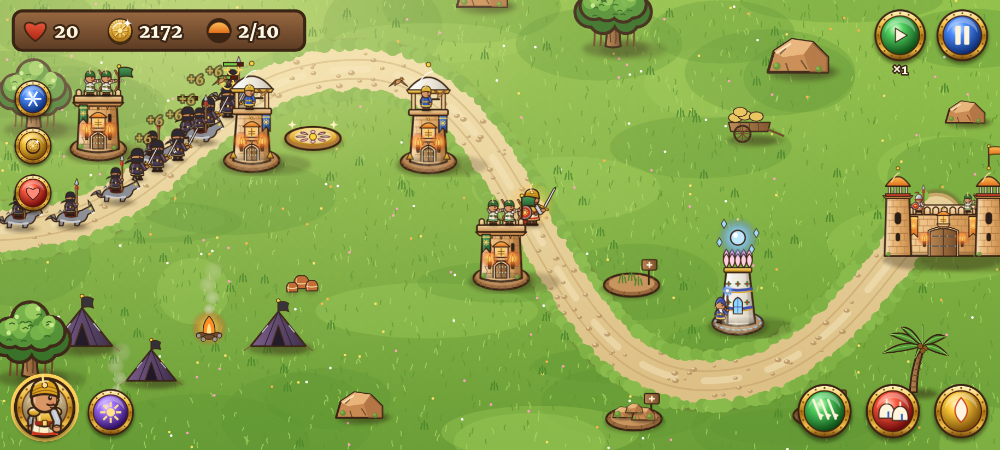
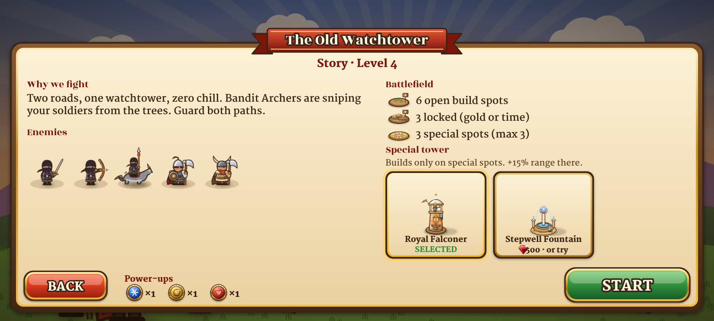
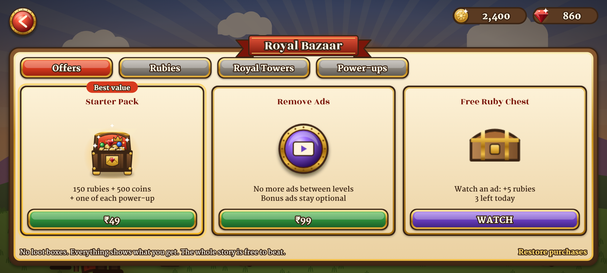

# PRD: Sandstone Kingdom: Tower Defense

| | |
|---|---|
| **Product** | Sandstone Kingdom: Tower Defense (Android, Google Play, worldwide) |
| **Package** | `com.samvardhanstudios.sandstonekingdom` |
| **Studio** | Samvardhan Studios |
| **Version** | 1.0 (launch: Region 1, Aravalli Hills) · document of 3 November 2026 |
| **Status** | Built and playable. The Android APK/AAB is built by CI; it waits on the Founder's store setup ([release-setup.md](../release-setup.md)) |

**Related docs:** [Art bible](art-bible.md) (every character, building and place) · [Level design](levels.md) · [Screens and flows](screens.md) · [Technical design](tech.md) · [QA test plan](qa-test-plan.md) · [Game design document](../game-design.md) · [Release setup](../release-setup.md)

---

## 1. Summary

A cartoon tower defense game set in medieval India. Players build Archer Towers, Barracks, Mage
Towers and Cannons along winding roads, lead the Sun Knight into battle and cast spells to stop
waves of bandits, barbarians and bosses. The story is a journey through six regions and seasons
of India. Launch ships Region 1 with 6 levels (a tutorial and 5 levels, the 5th a boss), three
game modes and the full meta game. Regions 2 to 6 come as free updates; their art is already made.

**Why it can win:** tower defense is a proven, evergreen genre on mobile with strong ad and
in-app revenue. An Indian setting is rare in the genre, looks fresh worldwide, and gives a strong home
market. Prices are set so players in India can easily pay, with fair local prices elsewhere.

## 2. Goals and success measures

| Goal | Measure (first 90 days) |
|---|---|
| Players enjoy it and come back | Day-1 retention ≥ 35%, day-7 ≥ 12%, Play rating ≥ 4.3 |
| Fair, healthy money | ARPDAU ≥ $0.03 (India-heavy mix), ≥ 1.5% of players buy something, ads ≤ 1 interstitial per 3 minutes |
| Stable on every phone | Crash-free users ≥ 99.5%, ANR rate below Play's bad-behaviour limit, works from Android 7 (API 24) |
| Ready to grow | Regions 2 and 3 shipped as free updates within 3 months of launch |

**Not in v1:** multiplayer, chat, energy/stamina timers, loot boxes, iOS.

## 3. Target players

- **Core:** casual and mid-core mobile players aged 13 to 35 who like strategy and short sessions
  (3 to 6 minutes a level). India first, then Southeast Asia, the Middle East, Latin America, Europe and the US.
- **Tone:** easy to read and a bit cheeky. Story lines are short and casual so younger players get
  them at once ("Two roads, one watchtower, zero chill").
- **Devices:** any Android phone or tablet from about 2 GB RAM, landscape only.

## 4. Game modes

| Mode | How it unlocks | What it is | Rewards |
|---|---|---|---|
| **Story** | From the start (the tutorial plays on first launch) | Levels in order on the world map. Each level earns 1 to 3 diyas: 3 for losing no lives, 2 for losing 5 or fewer | Coins; diyas unlock Royal Workshop ranks |
| **Challenges** | Each level's 3 challenges unlock when you complete that level | Same map with a rule: one tower type only, no spells, no hero, a single life, and so on | **Rubies only**, once per challenge |
| **Endless** | Beat the region boss (the Bandit King) | Waves never stop and grow harder; a boss returns every 10th wave | Coins per wave reached; score on the leaderboards |

## 5. Core gameplay

- **Build spots** sit along the road. Tap one to choose a tower; tap a tower to upgrade it (3 tiers) or sell it (60% refund).
- **Locked spots:** rubble costs battle gold to clear; sundial spots open by themselves at a set wave.
- **Special spots** (up to 3 per level, gold lotus): +15% range, and the only place the royal tower chosen in the briefing can be built.
- **Towers:** Archer (fast, hits flying), Barracks (3 soldiers block the road), Mage (magic ignores armour), Cannon (splash).
- **Royal towers** (rubies, permanent): **Royal Falconer** (fast, marks prey for extra damage) and **Stepwell Fountain** (slows enemies, heals soldiers). Two more arrive with later regions.
- **Hero:** the Sun Knight fights on the road. Tap him, then tap the road to move him. **Sun Strike** damages and stuns a crowd.
- **Spells:** Arrow Rain (area volleys), Reinforcements (2 temporary soldiers), Holy Fire (burn and stun). They unlock as the story goes on.
- **Power-ups** (one of each per level, bought with coins or rubies): Freeze Bomb, Gold Boost, Extra Lives.
- **Waves:** call the next wave early for bonus gold. A "New enemy!" card introduces every new enemy once.
- **Difficulty:** every level adds a new enemy or a harder mix, and enemy health rises (×0.8 in the tutorial to ×1.38 at the boss). Balance is checked by a test bot on every build (see [tech.md](tech.md)).

Full numbers per level: [levels.md](levels.md). Every unit and building: [art-bible.md](art-bible.md).

## 6. Battle briefing (before every level)

Before each battle the player sees:
1. **Mode line**: Story level, Challenge name and rule, or Endless with best wave and score.
2. **Why we fight**: one or two casual lines of story.
3. **Enemies** on this map, with **NEW** tags on ones not met yet.
4. **Battlefield**: how many open, locked and special spots (special: max 3).
5. **Special tower picker**: royal towers on cards. The **default is the one used last time**. A royal tower not owned yet can be bought with rubies, or **tried for one battle with a rewarded ad**. Towers a challenge forbids are greyed out.
6. Power-ups owned, then **Back** and **Start**.

## 7. Meta game and economy

| Currency | Earned by | Spent on |
|---|---|---|
| Battle gold (per level) | Kills, early waves | Towers, upgrades, clearing rubble |
| Coins | Story wins (first win full; replays 40%), daily login, endless | Power-ups, Royal Workshop |
| Rubies (premium) | **Challenges and daily quests (rubies only)**, achievements, daily login, ad chest, purchases | Royal towers, power-ups |
| Diyas | Level ratings | Unlock Royal Workshop ranks (3, 9 and 15 diyas) |

- **Daily login:** a 7-day calendar (day 7 is a big royal chest). It works offline for guests; signed-in players get +20%. Missing a day restarts the calendar; turning the phone's clock back gives nothing.
- **Daily quests:** 3 a day (for example "Defeat 60 Bandits", "Win a level using only Archer Towers"), rubies only, plus a 15-ruby bonus chest for finishing all 3.
- **Royal Workshop:** 6 tracks × 3 ranks (+8% archer damage, +12% soldier health, −8% spell cooldown, and so on). Reset is free at any time.
- **Achievements:** 32, each paying rubies, mirrored to Google Play Games (1 secret: the peacock).

## 8. Monetisation

| Product | India | USA | Notes |
|---|---|---|---|
| Starter Pack (once) | ₹49 | $1.99 | 150 rubies + 500 coins + 3 power-ups; offered once after the first boss win |
| Ruby Handful / Pouch / Chest / Vault / Treasury | ₹29 / 99 / 199 / 449 / 999 | $0.99 / 2.99 / 5.99 / 11.99 / 24.99 | 80 / 330 / 800 / 1,900 / 5,000 rubies |
| Remove Ads (once) | ₹99 | $2.99 | Removes interstitials and banner; optional reward ads stay |

**Ads (AdMob), with player-friendly rules built into the code:**
- **Rewarded (always optional):** double a win's coins, revive once (+5 lives), try a royal tower for a battle, the free ruby chest (3 a day). At most 12 a day.
- **Interstitial:** only between levels, never before level 4, never right after a loss, at most once every 3 minutes, never with Remove Ads.
- **Banner:** only on the world map, small, top centre, and only after the first 3 wins.
- **Consent:** Google's UMP form where the law needs it. Ads are limited to Teen content or lower.

**Fair-play promises:** the whole story can be finished free; no loot boxes; no energy system.

## 9. Google Play Games, saves and rankings

- **Guests:** everything works offline; progress is saved on the phone.
- **Sign in with Google Play Games** (optional): achievements, leaderboards (Endless and Total Diyas), and **cloud save** through Saved Games. The merge keeps the furthest progress from both phones.
- **Guest rankings:** an optional public top-100 (Firebase) so guests can see the endless rankings too. Impossible scores are rejected.
- **In-app review** prompt after the first boss win.

## 10. Screens

Main menu · World map (story and challenge modes) · Challenge list · Battle briefing · Battle HUD · Victory / Defeat / Endless results ·
Shop (4 tabs) · Daily reward · Daily quests · Royal Workshop · Achievements · Rankings · Settings.
Every screen with images, contents and flows: [screens.md](screens.md).

## 11. Audio

All music and sound are **synthesised in code**: no recordings, so nothing to license.
- **Music:** raga Bhupali scale. A tanpura drone, a bansuri-like flute with slides, and a tabla groove in battle (faster for bosses).
- **Sound effects:** a distinct sound for each tower, a dhol hit at wave start, coin chinks, the boss roar, spell sounds, and victory and defeat fanfares.
- Separate music and effects volume sliders; audio pauses when the app goes to the background.

## 12. Works on every Android phone

- Landscape only. The battlefield (844×390) scales to fit **without stretching**; wider phones and tablets see extra scenery instead of black bars.
- The HUD is pinned to the real screen edges and avoids notches; touch targets are 44 pt or more; text shrinks to fit its box.
- Sharp art at the phone's real pixel density (up to 3×). Battery saver (30 fps). Large-text option.
- **Checked automatically** on 7 screen shapes (16:9 to 21:9 phones, 16:10 and 4:3 tablets) on every screen.

## 13. Privacy, age rating and policy

- Target audience 13+, IARC around 7+ (cartoon fantasy violence). No chat, no personal data asked.
- Privacy policy, terms, age rating, `ads.txt` and `app-ads.txt` are on the `website` branch, to be hosted on samvardhanstudios.com.
- In-game **Delete my data**, **Ad privacy choices**, **Restore purchases**.

## 14. Release plan and roadmap

| Version | Contents |
|---|---|
| **1.0** | Region 1 (tutorial + 5 levels + boss), Story, Challenges (15), Endless, 2 royal towers, full meta game, ads, purchases, Play Games |
| 1.1 | Region 2: Thar Desert (levels 6–10), sandstorm weather, Dune Colossus boss, endless leaderboard 2 |
| 1.2 | Region 3: Western Ghats (monsoon, river paths), Storm Serpent boss, 3rd royal tower (Alchemist) |
| 1.3 to 1.5 | Regions 4 to 6, War Elephant Stable, the Shadow Emperor finale, more heroes and tier-3 specialisations |
| Later | Weekly challenge and live events, translations (Hindi first), cutscenes, the encyclopedia |

Release steps: internal testing, then closed testing (12+ testers for 14 days), then production with a 10% / 50% / 100% staged rollout.

## 15. Risks

| Risk | Mitigation |
|---|---|
| Too hard or too easy | The bot plays every level and challenge on every build; Remote Config tuning planned |
| Ad revenue below plan | Rewarded ads are the core; add AdMob mediation (AppLovin, Unity) after launch |
| A store-policy rejection | No loot boxes, clear ad rules, data-safety answers in [release-setup.md](../release-setup.md) |
| Low-end phones stutter | Art is pre-rendered to bitmaps once; battery-saver mode; tested at 1.5× density |
| Lost signing key | Play App Signing on; upload key backed up offline |
