# Art bible: Sandstone Kingdom

Every image here is rendered straight from the game's drawing code (`game/src/art/`) by
`node game/tools/catalog.mjs`. Nothing is hand-painted or licensed, so there are no copyright
worries, and art changes show up here automatically when the catalog is re-run.

**Style:** cartoon tower defense with a medieval Indian theme. It uses bold dark-brown outlines,
warm sandstone and saffron colours, soft light from the top left, and gold trim for anything royal.
Names are in plain English (Archers, Knights, Holy Knights, Magic Caster).

## Hero and your army

<table>
<tr><td align="center" valign="bottom">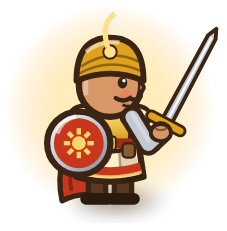 <b>The Sun Knight</b> Hero · moves on tap · Sun Strike stuns</td><td align="center" valign="bottom">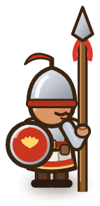 <b>Spearmen</b> Barracks tier 1</td><td align="center" valign="bottom">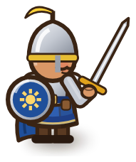 <b>Knights</b> Barracks tier 2</td><td align="center" valign="bottom">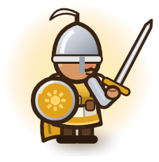 <b>Holy Knights</b> Barracks tier 3</td><td align="center" valign="bottom">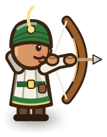 <b>Archers</b> on the Archer Tower</td><td align="center" valign="bottom">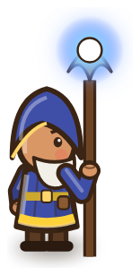 <b>Magic Caster</b> on the Mage Tower</td></tr>
</table>

## Enemies in the game now: Region 1, Aravalli Hills (8 + boss)

<table>
<tr><td align="center" valign="bottom">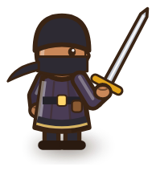 <b>Bandit</b> fast, comes in groups</td><td align="center" valign="bottom">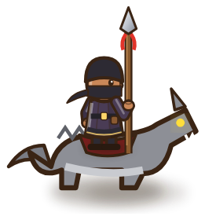 <b>Wolf Rider</b> very fast</td><td align="center" valign="bottom">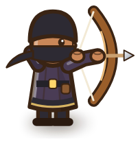 <b>Bandit Archer</b> shoots soldiers from range</td><td align="center" valign="bottom">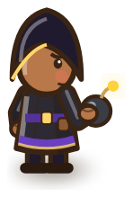 <b>Saboteur</b> slips past soldiers, jams towers</td><td align="center" valign="bottom">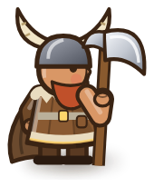 <b>Barbarian</b> tough, hits soldiers hard</td></tr>
<tr><td align="center" valign="bottom">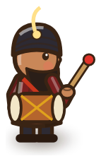 <b>War Drummer</b> enhancer: speeds up and strengthens allies</td><td align="center" valign="bottom">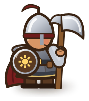 <b>Armored Brute</b> heavy armour, weak to magic</td><td align="center" valign="bottom">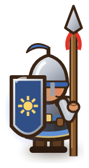 <b>Shield Bearer</b> shields comrades, strongest first</td><td align="center" valign="bottom">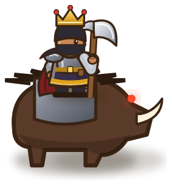 <b>The Bandit King</b> boss · calls bandits</td></tr>
</table>

## Animation

Every soldier, hero and enemy has five frames: idle, two walking steps (legs swing from the hip,
the body bobs) and two attack poses (wind-up and strike). Archers on the towers loose their arrows.

<table>
<tr><td align="center" valign="bottom">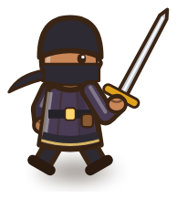 <b>Walk, step 1</b></td><td align="center" valign="bottom">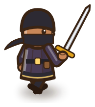 <b>Walk, step 2</b></td><td align="center" valign="bottom">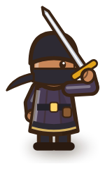 <b>Attack</b></td><td align="center" valign="bottom">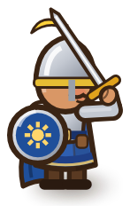 <b>Knight strike</b></td><td align="center" valign="bottom">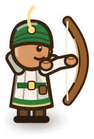 <b>Archer looses</b></td></tr>
</table>

## Enemies ready for the next regions (free updates)

Each region brings new enemies and a boss on every 5th level.

| Region · season | Enemies |
|---|---|
| **Thar Desert** · summer | 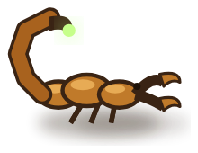 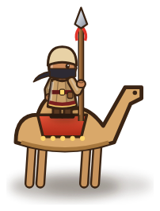   Scorpion Swarm · Camel Raider · Sand Burrower · **Boss: Dune Colossus** |
| **Western Ghats** · monsoon | 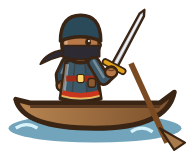 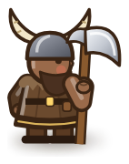 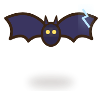 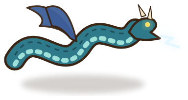 River Raider · Mud Brute · Storm Bat · **Boss: Storm Serpent** |
| **Deccan Ruins** · autumn | 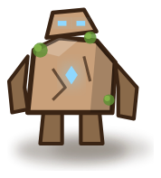 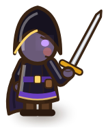 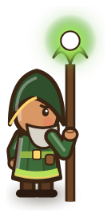 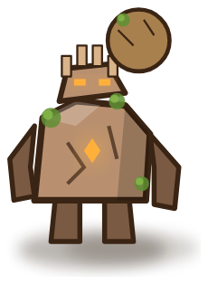 Stone Golem · Night Stalker · Shaman · **Boss: Stone Titan** |
| **Sundarbans** · pre-winter | 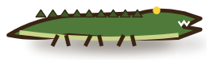 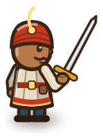 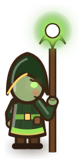 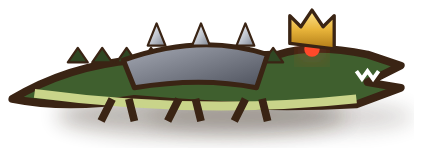 Crocodile · River Pirate · Swamp Witch · **Boss: Crocodile Warlord** |
| **Himalayas** · winter | 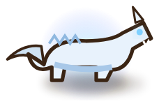 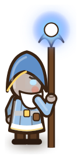  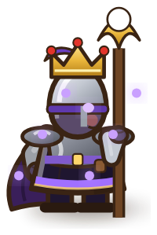 Ice Wolf · Frost Mage · Yeti Brute · **Final boss: Shadow Emperor** |

## Towers: three tiers, each clearly different

Tier 1 is a small outpost behind a wooden palisade; tier 2 a taller tower with gold studs and
pennants; tier 3 a grand tower on a marble plinth with domed pavilions, banners and a crest.
Upgrading plays a pillar of golden light and "UPGRADED!".

<table>
<tr><td align="center" valign="bottom">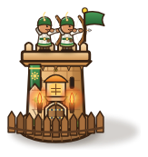 <b>Archer Tower · tier 1</b> Archers</td><td align="center" valign="bottom">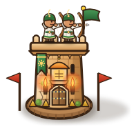 <b>Archer Tower · tier 2</b> Marksmen</td><td align="center" valign="bottom">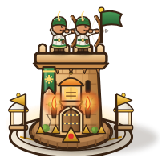 <b>Archer Tower · tier 3</b> Royal Longbows</td></tr>
<tr><td align="center" valign="bottom">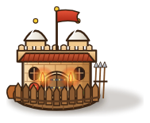 <b>Barracks · tier 1</b> Spearmen</td><td align="center" valign="bottom"> <b>Barracks · tier 2</b> Knights</td><td align="center" valign="bottom">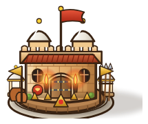 <b>Barracks · tier 3</b> Holy Knights</td></tr>
<tr><td align="center" valign="bottom">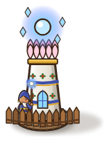 <b>Mage Tower · tier 1</b> Magic Caster</td><td align="center" valign="bottom">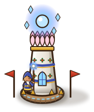 <b>Mage Tower · tier 2</b> Arcane Sage</td><td align="center" valign="bottom">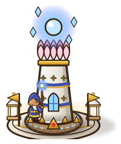 <b>Mage Tower · tier 3</b> Sun Mage</td></tr>
<tr><td align="center" valign="bottom">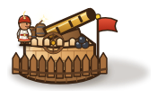 <b>Cannon Tower · tier 1</b> Cannon</td><td align="center" valign="bottom">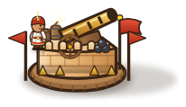 <b>Cannon Tower · tier 2</b> Bombard</td><td align="center" valign="bottom">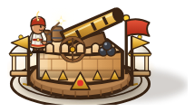 <b>Cannon Tower · tier 3</b> Thunder Cannon</td></tr>
</table>

## Special towers: 8 levels, up to 3 per battle, only on special spots

Unlocked with rubies or a big pile of coins (the Royal Falconer is a free story reward). Their look
changes every two levels; gold pips under the tower show its level.

<table>
<tr><td align="center" valign="bottom">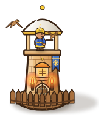 <b>Royal Falconer</b> levels 1–2</td><td align="center" valign="bottom">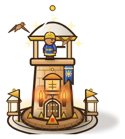 <b>Royal Falconer</b> levels 7–8</td><td align="center" valign="bottom"> <b>Stepwell Fountain</b> levels 1–2</td><td align="center" valign="bottom"> <b>Stepwell Fountain</b> levels 7–8</td></tr>
</table>
<table>
<tr><td align="center" valign="bottom"> <b>Alchemist's Workshop</b> poison flasks, strips armour</td><td align="center" valign="bottom"> <b>Alchemist's Workshop</b> levels 7–8</td><td align="center" valign="bottom"> <b>War Elephant Stable</b> an elephant charges</td><td align="center" valign="bottom"> <b>The War Elephant</b> tramples and knocks back</td></tr>
</table>

<table>
<tr><td align="center" valign="bottom"> <b>The Fort</b> what you defend; also the menu and icon art</td></tr>
</table>

## Build spots

**Standard** spots take the four basic towers. **Rubble** costs battle gold to clear. **Special** spots (1 to 3 per level)
open one by one during the battle, or earlier for gold, and take only special towers.

<table>
<tr><td align="center" valign="bottom"> <b>Open spot</b></td><td align="center" valign="bottom"> <b>Special spot</b> max 3 per level</td><td align="center" valign="bottom"> <b>Rubble</b> clear with gold</td><td align="center" valign="bottom"> <b>Sundial</b> opens at wave N</td></tr>
</table>

## Scenery (Aravalli Hills)

<table>
<tr><td align="center" valign="bottom"> <b>Banyan</b></td><td align="center" valign="bottom"> <b>Palm</b></td><td align="center" valign="bottom"> <b>Rock</b></td><td align="center" valign="bottom"> <b>Stepwell</b></td><td align="center" valign="bottom"> <b>Shrine</b></td><td align="center" valign="bottom"> <b>Peacock</b></td></tr>
<tr><td align="center" valign="bottom"> <b>Tents</b></td><td align="center" valign="bottom"> <b>Campfire</b></td><td align="center" valign="bottom"> <b>Cart</b></td><td align="center" valign="bottom"> <b>Pond</b></td><td align="center" valign="bottom"> <b>Haystack</b></td><td align="center" valign="bottom"> <b>Pots</b></td></tr>
</table>

The peacock has a secret: tap it 10 times in battle for the *Peacock Whisperer* achievement.

## World environments

**World map:** a side-scrolling journey through six regions and seasons, with level nodes,
a boss shield on every 5th level, and diyas (lamps) earned on each node.

**Battlefields.** Each level has its own road layout, scenery and enemy camp (more in [levels.md](levels.md)):

| | |
|---|---|
|  Tutorial: Training Grounds |  1: Village at the Pass |
|  2: The Stepwell Road |  3: Banyan Crossing |
|  4: The Old Watchtower |  5: The Bandit King's Camp (boss) |

## UI art

<table>
<tr><td align="center" valign="bottom"> <b>Logo</b></td><td align="center" valign="bottom"> <b>Royal chest</b> day-7 reward, starter pack</td><td align="center" valign="bottom"> <b>Coin</b></td><td align="center" valign="bottom"> <b>Ruby</b></td><td align="center" valign="bottom"> <b>Diya</b> level rating, 1 to 3</td></tr>
</table>

**Palette:** sandstone `#e8b47a` · saffron `#f0912a` · royal red `#c8361d` · gold `#e0a224` · outline `#3a2414` · parchment `#fdf2d8` · grass `#7fb145`.
**Fonts:** Rozha One (titles), Martel (text). Both are under the SIL Open Font Licence and bundled in the game.
