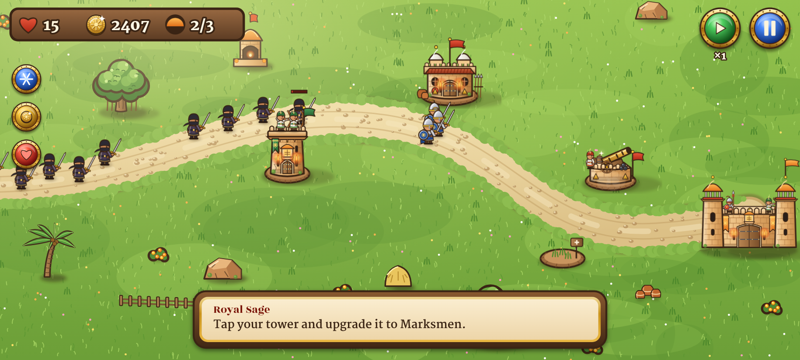
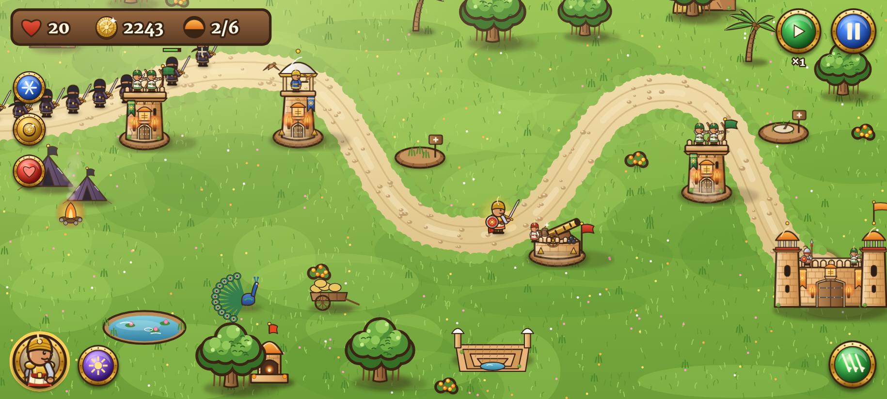
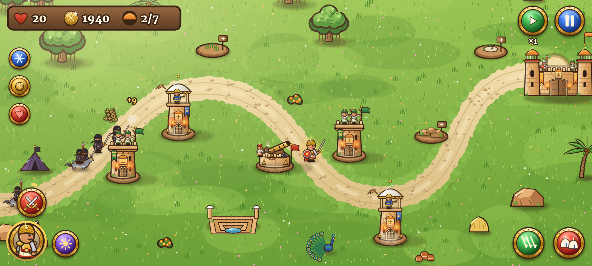
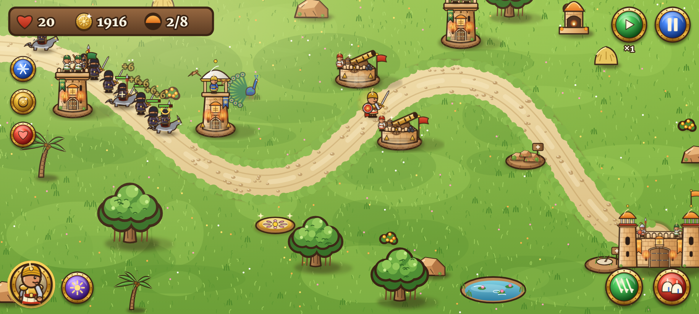
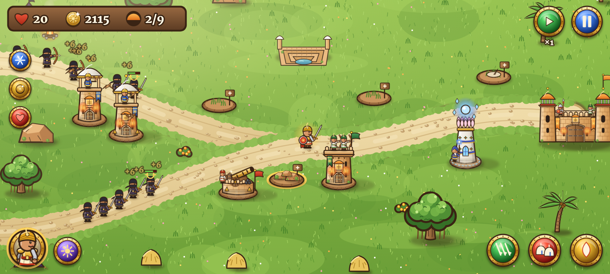
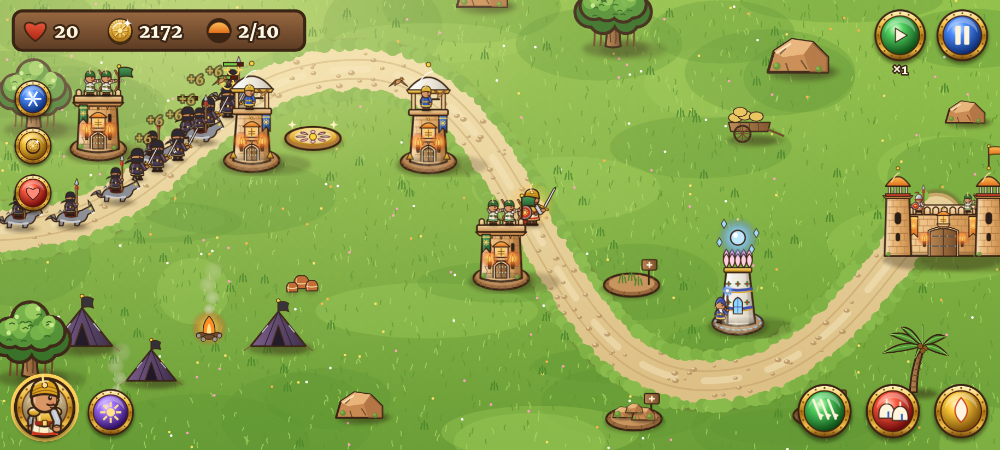

# Level design: Region 1, Aravalli Hills (Spring)

Generated from `game/src/engine/levels.js` by `node tools/levels-doc.mjs`, so the numbers match the game. The images show each battlefield mid-battle.

| # | Level | Start gold | Lives | Enemy HP | Waves | Spots (open / locked / special) | Spells | New enemy |
|---|---|---|---|---|---|---|---|---|
| 0 | Training Grounds | 160 | 15 | ×0.80 | 3 | 3 / 1 / 0 | 0 | Bandit |
| 1 | Village at the Pass | 230 | 20 | ×1.00 | 6 | 4 / 2 / 1 | 1 | - |
| 2 | The Stepwell Road | 300 | 20 | ×1.06 | 7 | 5 / 3 / 2 | 2 | Wolf Rider |
| 3 | Banyan Crossing | 330 | 20 | ×1.25 | 8 | 5 / 3 / 2 | 2 | Barbarian |
| 4 | The Old Watchtower | 380 | 20 | ×1.32 | 9 | 6 / 3 / 3 | 3 | Bandit Archer, Armored Brute |
| 5 | The Bandit King's Camp | 420 | 20 | ×1.38 | 10 | 6 / 3 / 3 | 3 | The Bandit King |

## Tutorial: Training Grounds

**Why we fight:** New recruit? No stress. The Royal Sage will show you the basics: build towers, stop the bandits, keep the fort safe. Easy W.

**Roads:** 1 · **Hero:** none (tutorial) · **Spells:** none

**Locked spots:** rubble (40 gold)

| Wave | Enemies |
|---|---|
| 1 | 4 × Bandit |
| 2 | 6 × Bandit |
| 3 | 8 × Bandit |

**Tutorial steps:** 1. Tap a build spot and choose the Archer Tower. 2. Ready! Tap the swords to call the first wave of bandits. 3. Tap your tower and upgrade it to Marksmen. 4. Rubble blocks the spot by the fort. Tap it and pay gold to clear it. 5. Build Barracks there: soldiers block the road. 6. Call waves early with the swords to earn bonus gold.

## Level 1: Village at the Pass

**Why we fight:** Bandits just raided the village market and ran off with the festival lamps. The whole village is counting on you. Time to lock in.

**Roads:** 1 · **Hero:** Sun Knight · **Spells:** Arrow Rain

**Locked spots:** rubble (50 gold), opens at wave 3

| Wave | Enemies |
|---|---|
| 1 | 6 × Bandit |
| 2 | 9 × Bandit |
| 3 | 12 × Bandit |
| 4 | 10 × Bandit, 6 × Bandit |
| 5 | 16 × Bandit |
| 6 | 22 × Bandit |

**Challenges (unlock after completing the level, each pays rubies once):**

- **Bowmen Only**: Win using only Archer Towers · 15 rubies
- **No Magic Words**: Win without casting spells · 15 rubies
- **Iron Fort**: Win with a single life · 20 rubies

## Level 2: The Stepwell Road

**Why we fight:** Now they want the stepwell, the only water for miles. No water, no village. Hold the road and don't let them through.

**Roads:** 1 · **Hero:** Sun Knight · **Spells:** Arrow Rain, Reinforcements

**Locked spots:** rubble (40 gold), opens at wave 4, rubble (80 gold)

| Wave | Enemies |
|---|---|
| 1 | 8 × Bandit |
| 2 | 3 × Wolf Rider |
| 3 | 10 × Bandit, 3 × Wolf Rider |
| 4 | 6 × Wolf Rider |
| 5 | 12 × Bandit, 4 × Wolf Rider |
| 6 | 7 × Wolf Rider, 10 × Bandit |
| 7 | 14 × Bandit, 8 × Wolf Rider |

**Challenges (unlock after completing the level, each pays rubies once):**

- **Without the Knight**: Win without the Sun Knight · 20 rubies
- **Bowmen Only**: Win using only Archer Towers · 20 rubies
- **Iron Fort**: Win with three lives · 25 rubies

## Level 3: Banyan Crossing

**Why we fight:** The hill Barbarians teamed up with the bandits. Bigger, tougher, hits harder. Do not let them cross the old banyan tree.

**Roads:** 1 · **Hero:** Sun Knight · **Spells:** Arrow Rain, Reinforcements

**Locked spots:** rubble (50 gold), opens at wave 5, rubble (70 gold)

| Wave | Enemies |
|---|---|
| 1 | 10 × Bandit |
| 2 | 5 × Wolf Rider |
| 3 | 2 × Barbarian |
| 4 | 12 × Bandit, 2 × Barbarian |
| 5 | 8 × Wolf Rider, 8 × Bandit |
| 6 | 4 × Barbarian, 10 × Bandit |
| 7 | 10 × Wolf Rider, 3 × Barbarian |
| 8 | 18 × Bandit, 5 × Barbarian, 6 × Wolf Rider |

**Challenges (unlock after completing the level, each pays rubies once):**

- **Heavy Guns**: Only Mage and Cannon Towers · 20 rubies
- **Shield Wall**: Only Barracks and Archer Towers · 20 rubies
- **Iron Fort**: Win with five lives · 25 rubies

## Level 4: The Old Watchtower

**Why we fight:** Two roads, one watchtower, zero chill. Bandit Archers are sniping your soldiers from the trees. Guard both paths.

**Roads:** 2 · **Hero:** Sun Knight · **Spells:** Arrow Rain, Reinforcements, Holy Fire

**Locked spots:** rubble (60 gold), opens at wave 4, rubble (80 gold)

| Wave | Enemies |
|---|---|
| 1 | 8 × Bandit (road 1), 8 × Bandit (road 2) |
| 2 | 4 × Bandit Archer (road 1) |
| 3 | 6 × Wolf Rider (road 1), 3 × Bandit Archer (road 2) |
| 4 | 1 × Armored Brute (road 1) |
| 5 | 3 × Barbarian (road 1), 10 × Bandit (road 2) |
| 6 | 6 × Bandit Archer (road 1), 1 × Armored Brute (road 2) |
| 7 | 10 × Wolf Rider (road 2), 4 × Barbarian (road 1) |
| 8 | 2 × Armored Brute (road 1), 6 × Bandit Archer (road 2), 14 × Bandit (road 1) |
| 9 | 3 × Armored Brute (road 2), 5 × Barbarian (road 1), 12 × Wolf Rider (road 1) |

**Challenges (unlock after completing the level, each pays rubies once):**

- **Shield Wall**: Only Barracks and Archer Towers · 25 rubies
- **Siege Crew**: Only Barracks, Mage and Cannon Towers · 25 rubies
- **Iron Fort**: Win with three lives · 30 rubies

## Level 5: The Bandit King's Camp (boss)

**Why we fight:** Boss fight. The Bandit King stole the Sun Crown, and without it spring never comes back. Go get it back. No pressure.

**Roads:** 1 · **Hero:** Sun Knight · **Spells:** Arrow Rain, Reinforcements, Holy Fire

**Locked spots:** rubble (60 gold), opens at wave 4, rubble (80 gold)

| Wave | Enemies |
|---|---|
| 1 | 12 × Bandit |
| 2 | 8 × Wolf Rider |
| 3 | 5 × Bandit Archer, 8 × Bandit |
| 4 | 4 × Barbarian |
| 5 | 2 × Armored Brute, 6 × Wolf Rider |
| 6 | 8 × Bandit Archer, 3 × Barbarian |
| 7 | 20 × Bandit, 2 × Armored Brute |
| 8 | 14 × Wolf Rider, 6 × Bandit Archer |
| 9 | 6 × Barbarian, 3 × Armored Brute |
| 10 | 10 × Bandit, 1 × The Bandit King, 4 × Barbarian, 8 × Wolf Rider |

**Challenges (unlock after completing the level, each pays rubies once):**

- **No Gunpowder**: Beat the Bandit King without Cannon Towers · 30 rubies
- **Arcane Guard**: Only Mage Towers and Barracks · 30 rubies
- **Untouchable King**: Beat him with ten lives · 40 rubies

## Endless mode

Unlocked by beating the Bandit King and played on his camp. After the 10 hand-made waves, new waves are generated: each one is bigger and mixes more enemy types. Enemy health grows about 9% per wave (a little faster each wave), and the Bandit King returns every 10th wave. Score: 10 × gold value per kill, 100 × wave number for each wave reached, plus a bonus for calling waves early.

## Regions 2 to 6 (free updates)

The enemy art for every region is ready (see the [art bible](art-bible.md)). Levels 6 to 30 follow the same pattern: a new enemy in most levels and a boss every 5th level.
