# Screens and flows

All images are from the game running at 915×412 (a Pixel 7 in landscape), rendered by
`node game/tools/catalog.mjs`. Every screen is also checked automatically on 7 phone and tablet shapes.

## Flow

```
first launch -> Tutorial battle -> Main menu
Main menu -> Story -> World map -> tap a level -> Battle briefing -> Battle -> Victory / Defeat -> World map
          -> Challenges -> World map (challenge mode) -> tap a level -> Challenge list -> Briefing -> Battle
          -> Endless (after the boss) -> Briefing -> Battle -> Results -> Rankings
          -> Shop · Daily · Quests · Workshop · Awards · Ranks · Settings
Android back button: closes a pop-up, pauses a battle, goes back a screen, or asks before leaving from the menu.
```

## Main menu
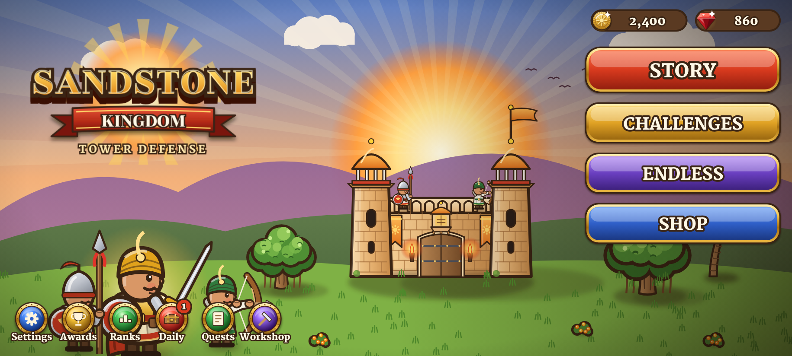

The fort at sunrise, the logo, three modes (Story, Challenges, Endless) and the Shop. Locks show on
modes that are not open yet. The corner buttons are Settings, Awards, Ranks, Daily, Quests and Workshop,
with red badges when something can be claimed. A Google Play sign-in button appears in the Android app.

## World map: story mode
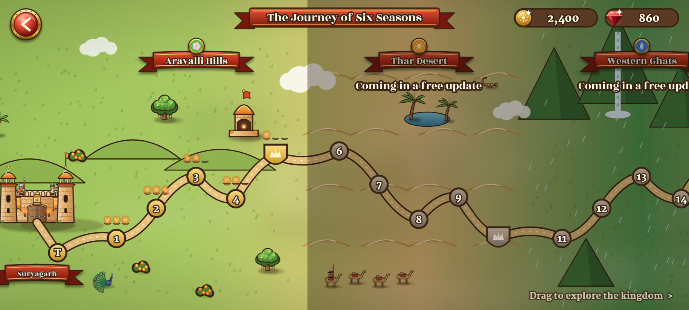

Drag left and right through the six regions. Each node shows its diyas; the next level glows with the
Sun Knight beside it; boss levels are shields. Regions after the first say "Coming in a free update".

## World map: challenge mode and challenge list
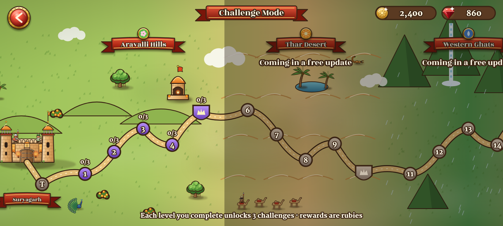
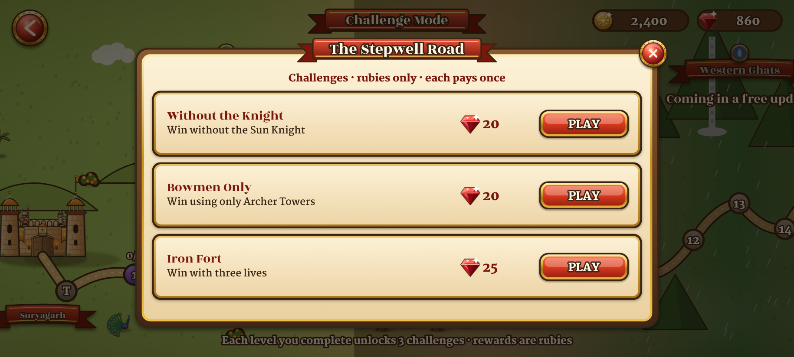

Each node shows how many of its 3 challenges are done (for example 2/3). Levels not completed in
Story stay locked. Each challenge shows its rule and ruby reward and pays once.

## Battle briefing
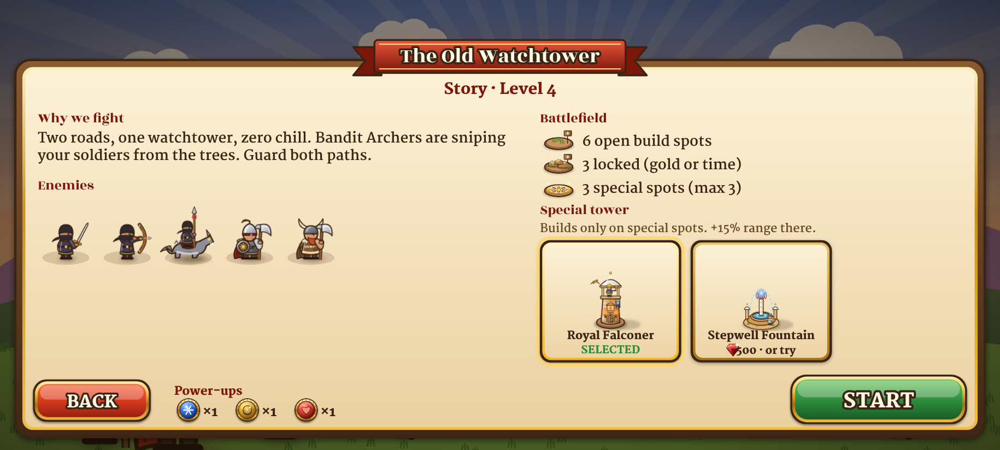
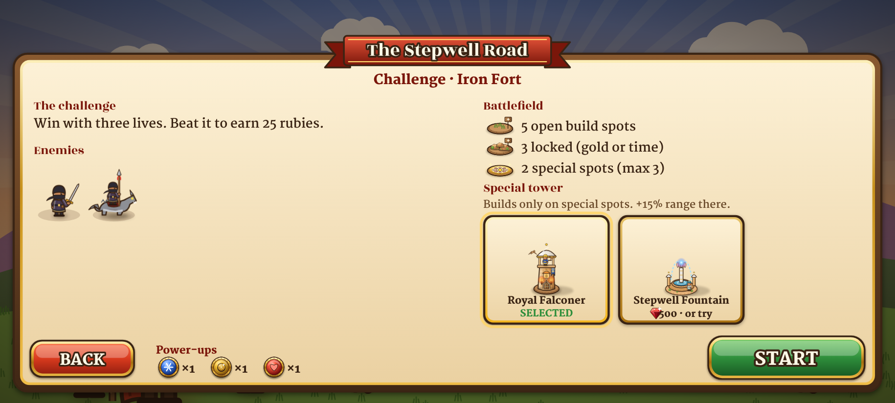
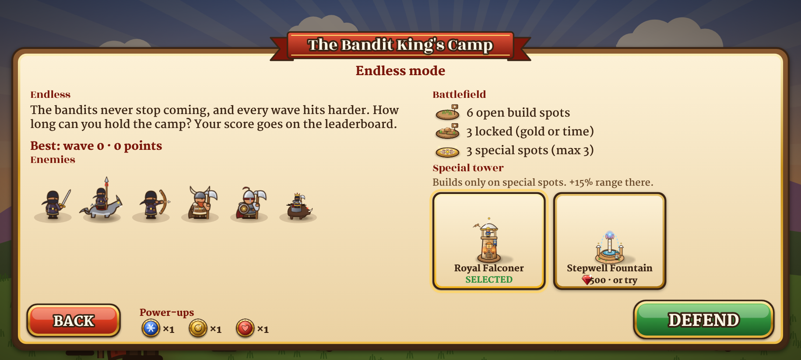

It shows the story line, the enemies (NEW tags), the build-spot counts (open, locked, special: max 3), the special tower
picker (the last one used is chosen by default; buy, or try with an ad), the power-ups, and Back and Start.

## Battle HUD
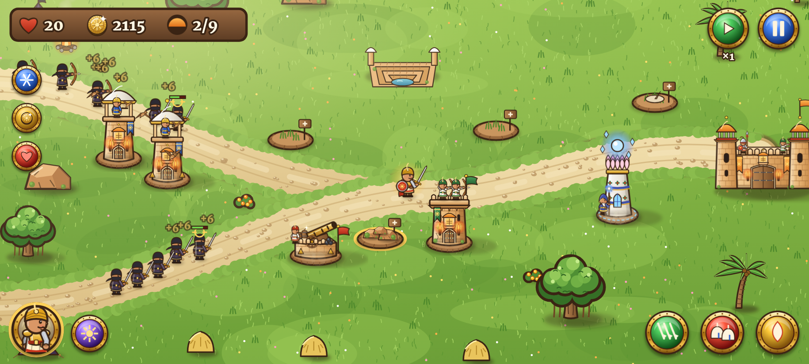

- **Top left:** lives, gold, wave; the challenge name or endless score below; power-up buttons.
- **Top right:** speed ×1/×2, pause.
- **Road entrance:** the swords button to start or call the next wave early, with a countdown ring and bonus.
- **Bottom left:** the Sun Knight's portrait (health ring, respawn timer), Sun Strike.
- **Bottom right:** the spells, with cooldown pies.
- **Build menu** around a spot: 4 towers (5 on a special spot), with prices. **Tower menu:** upgrade or MAX, sell.
- **Pop-ups:** new enemy card, pause, victory (diyas, coins, rubies, achievement, *Double coins (ad)*),
  defeat (*Revive +5 lives (ad)*, once), endless results (wave, score, best, Ranks).

## Shop
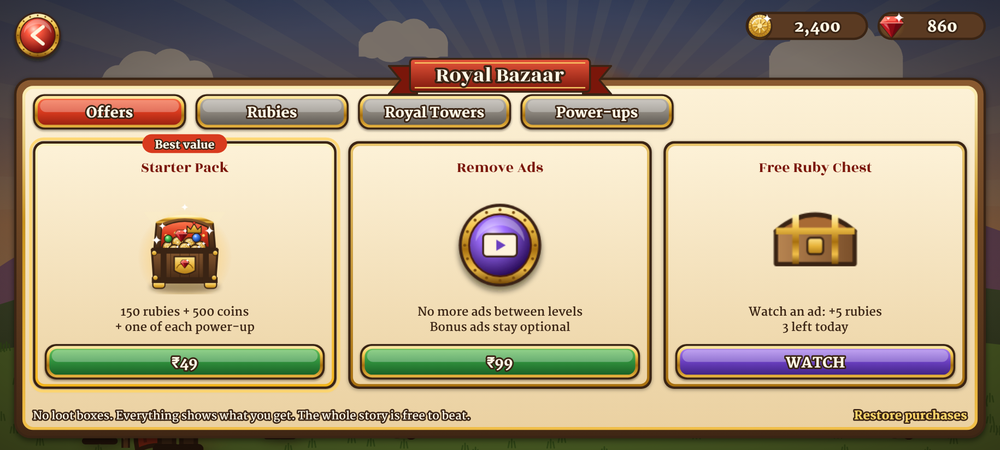
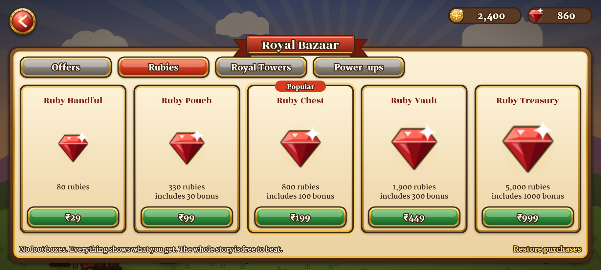
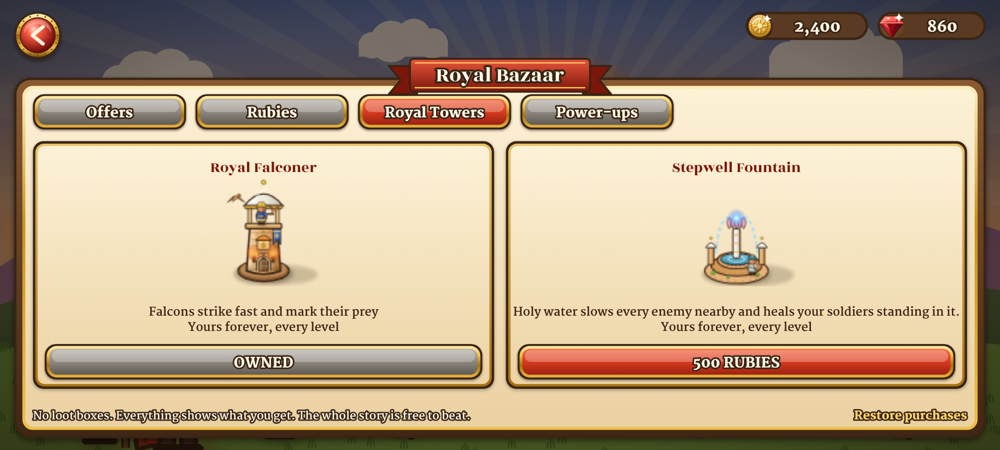
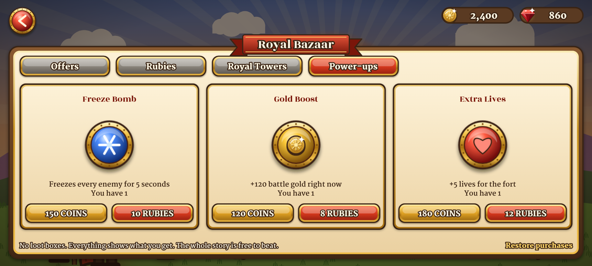

Four tabs: Offers (Starter Pack, Remove Ads, free ruby chest), Rubies, Royal Towers and Power-ups.
Prices come from Google Play in the player's currency. Restore purchases is at the bottom.

## Daily reward, quests and workshop
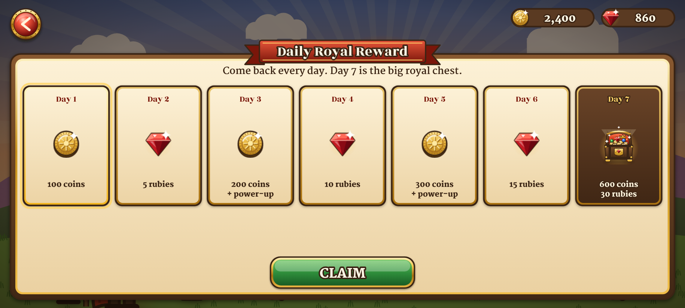
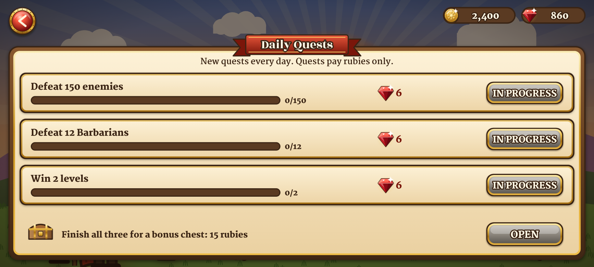
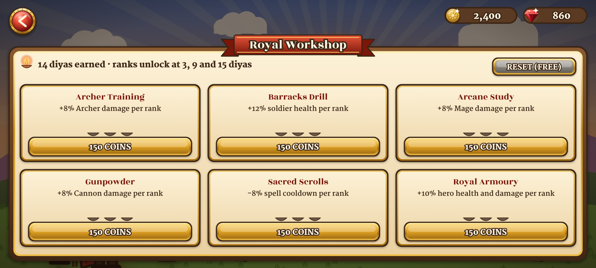

## Achievements, rankings and settings
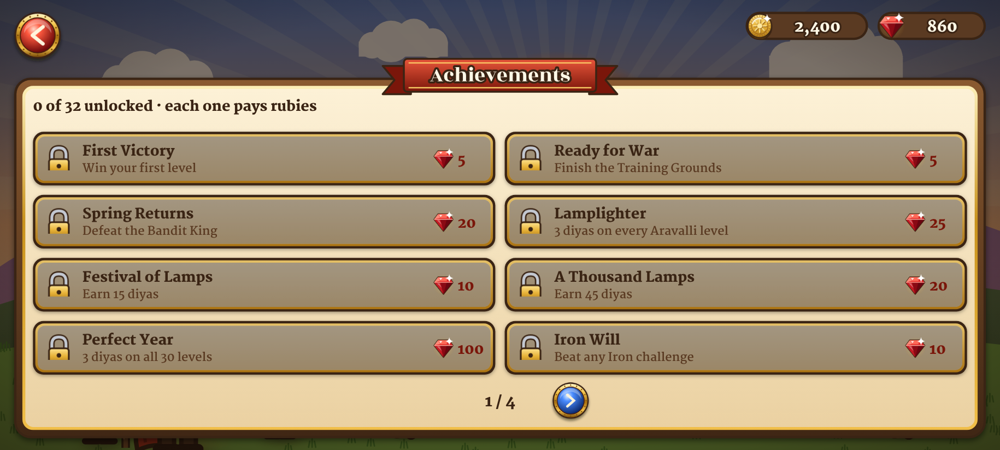
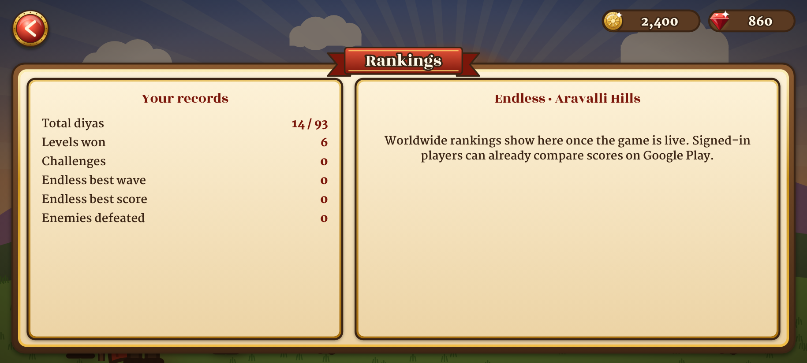
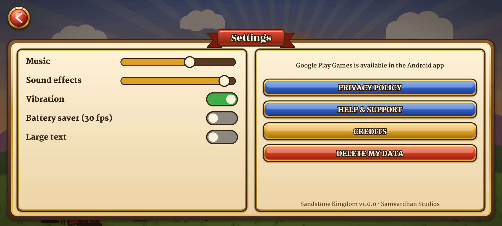

The settings are music and effects volume, vibration, battery saver, large text, Google Play sign-in,
ad privacy choices (where required), the privacy policy, help, credits, and delete my data.
